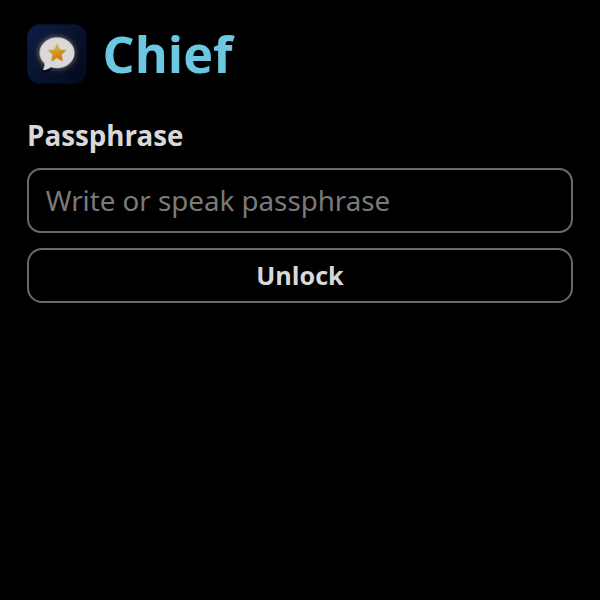
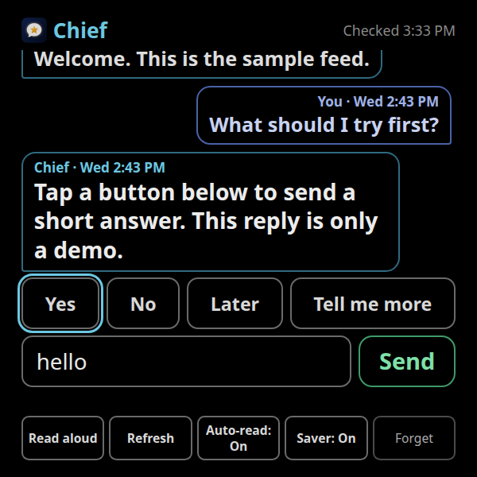
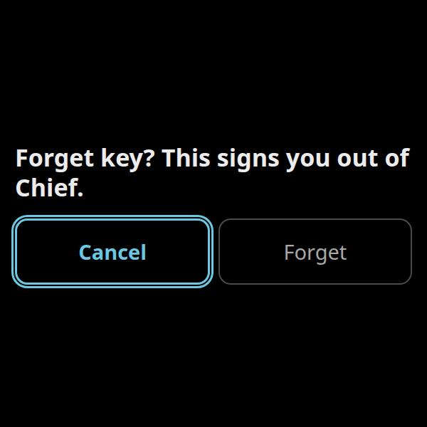
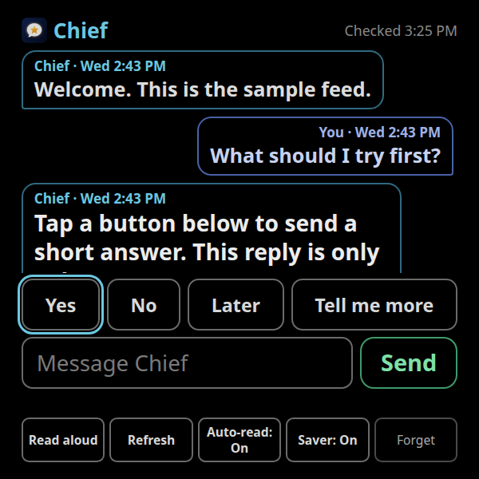

# Chief

Chief shows replies from your assistant on Meta Ray-Ban Display glasses, or in any web browser. The messages on the site are scrambled. Chief is not affiliated with Meta.

**Try it in 30 seconds.** Open the live demo: https://lugovelb.github.io/chief-glasses-open/ and type this passphrase (a secret phrase; this sample one is public):

```text
orbit maple cinder velvet quartz lantern
```

Nothing to install. The letters stay hidden. Click **Show** if you want to check what you typed.

## What it looks like







## Checklist

- [ ] 1. Open the live demo above and type the demo passphrase. No install.
- [ ] 2. Click **Use this template** or **Fork** (GitHub's button that copies this project into your account). Choose **Public**.
- [ ] 3. Edit `config.js` with the pencil icon. You can skip the `YOUR_` lines until you want Send to work.
- [ ] 4. Turn on GitHub Pages (the free switch that publishes your copy as a website): **Settings**, **Pages**, **Deploy from a branch**, branch **main**, folder **/ (root)**.
- [ ] 5. Open your new site address and type the demo passphrase. A red "not set up" line, if you tap Send, is expected.

## Make your own copy in the browser

You do not need a command line for this part.

The **Use this template** button is turned on at go-live (**Settings**, **General**, **Template repository**). You do not change that checkbox. If you do not see the button yet, click **Fork** instead. Either one makes your own copy.

1. Sign in to GitHub and open this project.
2. Click **Use this template** or **Fork**, then **Create a new repository**. Choose **Public**. Pick a name you will remember.
3. In your new copy, click `config.js`, then the pencil (**Edit this file**). Change only the words inside the quotes. Click **Commit changes** and commit to the `main` branch.

| Line | Name | What to put |
| --- | --- | --- |
| 9 | `web3formsKey` | Your email key from [Web3Forms](https://web3forms.com). This line sends email. Leave `YOUR_WEB3FORMS_KEY` for now if you only want to read the demo. |
| 14 | `formsubmitId` | Optional second email path from [FormSubmit](https://formsubmit.co). Paste the random id they email you, not your email address. Leave `YOUR_FORMSUBMIT_ID` to skip it. |
| 19 | `ntfyTopic` | Optional live updates from [ntfy.sh](https://ntfy.sh). Make up a long random name (letters, numbers, dashes). This is not email. Anyone who knows the name can post to it. Leave `YOUR_NTFY_TOPIC` to skip it. |
| 22 | `ntfyServer` | Leave `https://ntfy.sh`. |
| 25 | `feedUrl` | Leave `./feed.json`. That is the message file next to the page, including on GitHub Pages. |
| 30 | `apiFeedUrl` | Leave the quotes empty (`""`). |
| 34 | `timeZone` | Leave the quotes empty (`""`). The page uses the time zone of the browser or the glasses. |
| 37 | `assistantName` | Leave `"Chief"`, or change the label on incoming replies. |

Send works after you fill in **one** of line 9, line 14, or line 19. Lines 9 and 14 turn on email. Line 19 turns on ntfy. Reading the demo does not need any of them.

4. In your copy, open **Settings**, then **Pages**. Choose **Deploy from a branch**, branch **main**, folder **/ (root)**, and click **Save**.
5. Wait until GitHub shows a live address like `https://YOUR_NAME.github.io/YOUR_REPO/`. The glasses need that `https://` address.

Open it and type the demo passphrase. You should see the sample reply and the buttons **Yes**, **No**, **Later**, and **Tell me more**. If you tap Send, or one of those buttons, a red line says sending is not set up. That is expected until line 9, 14, or 19 is filled in.

## Send a message

Do this when you want your own reply on the site. The passphrase stays on your computer. It is never saved in the project.

1. On your GitHub copy, click the green **Code** button, then **Download ZIP**. Unzip it. That folder is your project folder. This step needs Python from [python.org](https://www.python.org/downloads/).
2. Double-click `send-message.bat` (Windows) or `send-message.sh` (Mac or Linux). The first time, it builds a private toolbox folder named `.venv`. Type your passphrase (six or more random words, not the demo phrase). The letters stay hidden. Then type the message. The first time, while the file is still the sample, type `START OVER` when it asks. That saves a backup, then replaces the sample.
3. Back on GitHub, click **Add file**, then **Upload files**. Drop in the new `feed.json` only. Do not upload `.venv`. Commit it to `main`. Wait a minute, reload your site, and unlock with your passphrase. The demo passphrase stops working. That is expected.

If the Mac or Linux file opens as text, open Terminal, type `cd ` with a space, drag the folder onto the window, press Enter, then run `./send-message.sh`.

## On the glasses

This uses Meta's developer preview. The taps change. Chief is not an official Meta app. On Meta's pages, skip any section about AI coding tools.

1. Turn on Developer Mode using only this section: [Enabling Developer Mode in the Meta AI app](https://wearables.developer.meta.com/docs/develop/webapps/setup/#enabling-developer-mode-in-the-meta-ai-app).
2. Add the page by its address using only this section: [Load the Web App on your glasses](https://wearables.developer.meta.com/docs/develop/webapps/test/#load-the-web-app-on-your-glasses).
3. Use the `https://` address from Pages. Do not use `http://` or `127.0.0.1`.
4. On the glasses, open Chief and type your passphrase. The reply buttons (Yes, No, Later, Tell me more) sit under the chat and above the message box. Swipe back to them from the message box, Send, or Forget. Pinch or Select sends the highlighted one. Select a message to jump back to Yes.



**Forget** asks a second time. **Cancel** is the highlighted choice. Confirming Forget removes the passphrase from this device only. Closing the page with the glasses' back control keeps the chat for next time.

Quick replies are on unless you add `?replies=0` to the address.

## Security

- Use six or more random words. The scrambled file is public, so a short phrase can be guessed.
- The demo passphrase is public. Do not reuse it.
- Messages are scrambled with AES-256-GCM. The passphrase is stretched with PBKDF2-SHA256 for 310,000 iterations.
- Chief remembers the passphrase on this device. It is stored in the browser's local storage on that device. **Forget** clears it from this device. It does not delete the public file.
- The Web3Forms key, the FormSubmit id, and the ntfy name are not the passphrase. They are public on purpose. Someone with the Web3Forms key can email your inbox. They still cannot read the feed.
- Do not put your email address in `config.js`. Do not commit the passphrase.

Command-line setup, local preview, troubleshooting, and the FAQ are in [SETUP.md](SETUP.md).

## Support

Chief is free. To support the work: https://paypal.me/lugovelb

MIT license. See [LICENSE](LICENSE).
