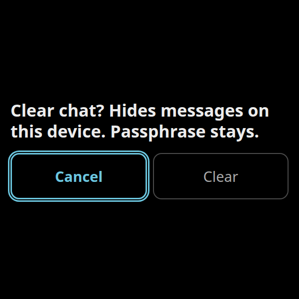
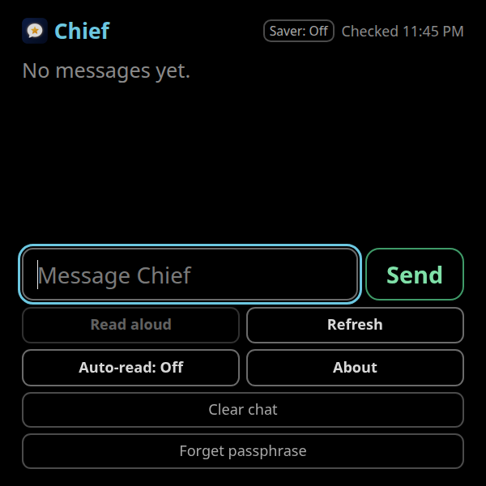
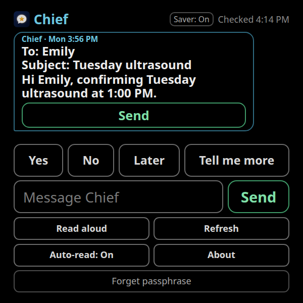
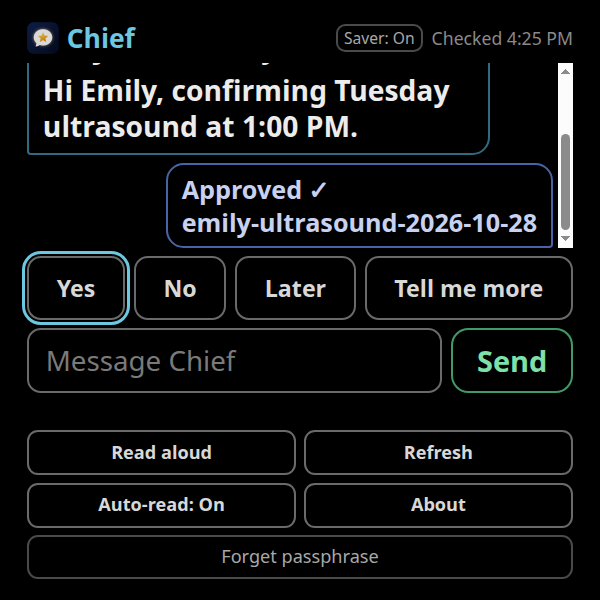
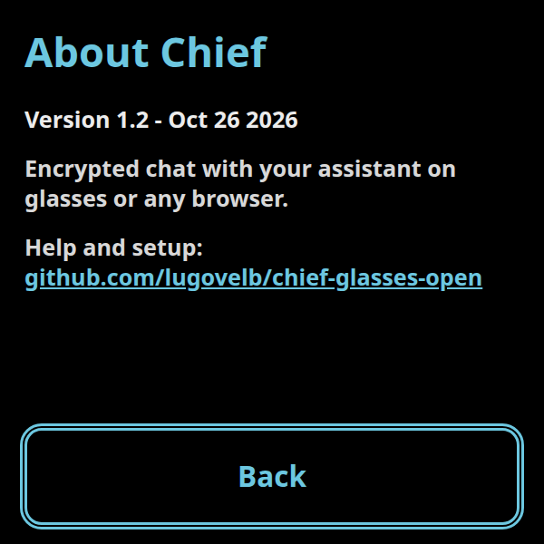

# Chief: Grok, ChatGPT, Claude, Gemini and Cursor on your Meta Ray-Ban Display glasses

Tested with Grok Bot. Other AIs work if they can run the send script and upload to GitHub.

Chief shows replies from your assistant on Meta Ray-Ban Display glasses, or in any web browser. The messages on the site are scrambled. Chief is not affiliated with Meta.

This repository is the public template. Use **Use this template** or **Fork** to make your own copy. It does not ship a private host, a personal feed, or anyone else's keys.

**Try it in 30 seconds.** Open the live demo: https://lugovelb.github.io/chief-glasses-open/ and type this passphrase (a secret phrase; this sample one is public):

```text
orbit maple cinder velvet quartz lantern
```

Nothing to install. The letters stay hidden. Click **Show** if you want to check what you typed.

**Quest browser demo.** A one-minute clip of the same Chief web app in a Meta Quest headset (mixed reality, hand tracking): [watch the clip](https://github.com/lugovelb/chief-glasses-open/releases/download/demo-quest-2026-10-25/chief-demo-clip-2026-10-25.mp4). This is a browser demo, not Meta Ray-Ban Display lens footage. [Release page](https://github.com/lugovelb/chief-glasses-open/releases/tag/demo-quest-2026-10-25).

## What it looks like












## Checklist

- [ ] 1. Open the live demo above and type the demo passphrase. No install.
- [ ] 2. Click **Use this template**, then **Create a new repository**, and choose **Public**. If that button is missing, click **Fork**, then **Create fork**.
- [ ] 3. Edit `config.js` with the pencil icon. You can skip the `YOUR_` lines until you want Send to work.
- [ ] 4. Turn on GitHub Pages (the free switch that publishes your copy as a website): **Settings**, **Pages**, **Deploy from a branch**, branch **main**, folder **/ (root)**.
- [ ] 5. Open your new site address and type the demo passphrase. A red "not set up" line, if you tap Send, is expected.

## Make your own copy in the browser

You do not need a command line for this part.

The **Use this template** button is turned on at go-live (**Settings**, **General**, **Template repository**). You do not change that checkbox. If you do not see the button yet, use **Fork** instead. Either one makes your own copy.

1. Sign in to GitHub and open this project.
2. Click **Use this template**, then **Create a new repository**. Choose **Public**. If that button is missing, click **Fork**, then **Create fork**. Pick a name you will remember.
3. In your new copy, click `config.js`, then the pencil (**Edit this file**). Change only the words inside the quotes. Click **Commit changes** and commit to the `main` branch.

| Line | Name | What to put |
| --- | --- | --- |
| 9 | `web3formsKey` | Your email key from [Web3Forms](https://web3forms.com). This line sends email. Leave `YOUR_WEB3FORMS_KEY` for now if you only want to read the demo. |
| 14 | `formsubmitId` | Optional second email path from [FormSubmit](https://formsubmit.co). Paste the random id they email you, not your email address. Leave `YOUR_FORMSUBMIT_ID` to skip it. |
| 19 | `ntfyTopic` | Optional live updates from [ntfy.sh](https://ntfy.sh). Make up a long random name (letters, numbers, dashes). This is not email. Anyone who knows the name can post to it. Leave `YOUR_NTFY_TOPIC` to skip it. |
| 22 | `ntfyServer` | Leave `https://ntfy.sh`. |
| 25 | `feedUrl` | Leave `./feed.json`. That is the message file next to the page, including on GitHub Pages. |
| 30 | `apiFeedUrl` | Leave the quotes empty (`""`). |
| 34 | `timeZone` | Leave the quotes empty (`""`). The page uses the time zone of the browser or the glasses. |
| 37 | `assistantName` | Leave `"Chief"`, or change the label on incoming replies. |

Send works after you fill in **one** of line 9, line 14, or line 19. Lines 9 and 14 turn on email. Line 19 turns on ntfy. Reading the demo does not need any of them.

4. In your copy, open **Settings**, then **Pages**. Choose **Deploy from a branch**, branch **main**, folder **/ (root)**, and click **Save**.
5. Wait until GitHub shows a live address like `https://YOUR_NAME.github.io/YOUR_REPO/`. The glasses need that `https://` address.

Open it and type the demo passphrase. You should see the sample reply and the buttons **Yes**, **No**, **Later**, and **Tell me more**. If you tap Send, or one of those buttons, a red line says sending is not set up. That is expected until line 9, 14, or 19 is filled in.

## Send a message

Do this when you want your own reply on the site. The passphrase stays on your computer. It is never saved in the project.

1. On your GitHub copy, click the green **Code** button, then **Download ZIP**. Unzip it. That folder is your project folder. This step needs Python from [python.org](https://www.python.org/downloads/).
2. Double-click `send-message.bat` (Windows) or `send-message.sh` (Mac or Linux). The first time, it builds a private toolbox folder named `.venv`. Type your passphrase (six or more random words, not the demo phrase). The letters stay hidden. Then type the message. The first time, while the file is still the sample, type `START OVER` when it asks. That saves a backup, then replaces the sample.
3. Back on GitHub, click **Add file**, then **Upload files**. Drop in the new `feed.json` only. Do not upload `.venv`. Commit it to `main`. Wait a minute, reload your site, and unlock with your passphrase. The demo passphrase stops working. That is expected.

If the Mac or Linux file opens as text, open Terminal, type `cd ` with a space, drag the folder onto the window, press Enter, then run `./send-message.sh`.

## On the glasses

This uses Meta's developer preview. The taps change. Chief is not an official Meta app. On Meta's pages, skip any section about AI coding tools.

1. Turn on Developer Mode using only this section: [Enabling Developer Mode in the Meta AI app](https://wearables.developer.meta.com/docs/develop/webapps/setup/#enabling-developer-mode-in-the-meta-ai-app).
2. Add the page by its address using only this section: [Load the Web App on your glasses](https://wearables.developer.meta.com/docs/develop/webapps/test/#load-the-web-app-on-your-glasses).
3. Use the `https://` address from Pages. Do not use `http://` or `127.0.0.1`.
4. On the glasses, open Chief and type your passphrase. The reply buttons (Yes, No, Later, Tell me more) sit under the chat and above the message box. Swipe up into the chat to read older messages, then swipe down to the buttons. When a drafted email is showing, Down at the bottom of the transcript highlights that draft's **Send**, and Down again highlights **Yes**. Up from **Yes** returns to that **Send**, then the transcript. Swipe back to the buttons from the message box, Clear chat, or Forget. Pinch or Select sends the highlighted one. Select a message to jump back to Yes.

**About** is with **Read aloud**, **Refresh**, and **Auto-read**. **Clear chat** is a wide quiet row under those. **Forget passphrase** is the wide quiet row under Clear chat. **Saver** is the quiet control in the header, next to the clock. **Back** on the About screen returns to the chat. The glasses' back control does the same.

A drafted email is drawn with its real **To**, **Subject**, and body. One green **Send** sits under that draft only. The **Send** beside the message box is still how you talk to your assistant.


**Clear chat** asks a second time. **Cancel** is the highlighted choice. Confirming it hides the messages already loaded on this device. The passphrase stays, and the chat stays unlocked. A message that is still sending, or that failed to send, stays on screen. A reply that was not loaded yet, or that arrives later, still shows on Refresh. **Forget** asks a second time. **Cancel** is the highlighted choice. Confirming Forget removes the passphrase from this device only. Closing the page with the glasses' back control keeps the chat for next time.

Quick replies are on unless you add `?replies=0` to the address.

Spanish is available. Add `?lang=es` to the address, or tap **English** / **Español** under Unlock on the lock screen. Chief remembers the choice on this device. `?lang=en` switches back.

## Draft email

When your assistant publishes a drafted email, the bubble shows **To**, **Subject**, and the body. Chief does not show the free-form `text` on that message, so the line on the glasses is the email you would approve.

The green **Send** under the draft is the approval. It sends an owner message whose text is `SEND_DRAFT`, the draft id, and the `draftHash`, separated by spaces. The kind is `send_draft`. After it sends, your bubble says **Approved ✓** and the draft id. The bubble does not show the `SEND_DRAFT` line.

These do not approve a draft:

- A normal chat message, including one you type in the message box
- **Yes**, **No**, **Later**, or **Tell me more**
- The words `SEND_DRAFT` with no `send_draft` kind, or a `send_draft` message that is not from you

The hash is the first 12 lowercase hex characters of SHA-256 over the length-prefixed fields, in order: To, Subject, body. Each field is its UTF-8 byte length, written in decimal, then a newline byte, then the field's UTF-8 bytes. The worked example is in [SETUP.md](SETUP.md).

New words for the same draft id make a new hash. **Send** stays under that draft until an owner `send_draft` message carries the new hash. An older approval does not cover the new text.

To put a draft in your own feed, from the project folder, with `CHIEF_PASSPHRASE` already set:

```bash
python publish.py --draft-id emily-ultrasound-2026-10-28 \
  --to "Emily" \
  --subject "Tuesday ultrasound" \
  --body "Hi Emily, confirming Tuesday ultrasound at 1:00 PM."
```

The stored `text` is only a fallback for an older page. This page ignores it on a draft.

## About

**About** shows version **1.2**, dated **Oct 26 2026**, a one-line description of Chief, and the help link for this public template: https://github.com/lugovelb/chief-glasses-open. **Back** returns to the chat.

## Security

- Use six or more random words. The scrambled file is public, so a short phrase can be guessed.
- The demo passphrase is public. Do not reuse it.
- Messages are scrambled with AES-256-GCM. The passphrase is stretched with PBKDF2-SHA256 for 310,000 iterations.
- Chief remembers the passphrase on this device. It is stored in the browser's local storage on that device. **Clear chat** hides messages already on this device and keeps the passphrase. **Forget** clears the passphrase from this device. Neither one deletes the public file.
- The Web3Forms key, the FormSubmit id, and the ntfy name are not the passphrase. They are public on purpose. Someone with the Web3Forms key can email your inbox. They still cannot read the feed.
- Do not put your email address in `config.js`. Do not commit the passphrase.

Command-line setup, local preview, troubleshooting, and the FAQ are in [SETUP.md](SETUP.md).

## Support

Chief is free. To support the work: https://paypal.me/lugovelb

MIT license. See [LICENSE](LICENSE).
